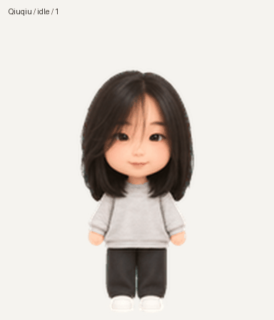

# 球球 · Qiuqiu

以人像照片为灵感制作的柔和 Q 版动画伙伴：黑色中长发、灰白条纹上衣、深灰长裤和白鞋。采用原始无痣造型。

## 成品

- [透明精灵图](spritesheet.png)：1536×2288 PNG，v2，8列×11行，每格192×208，共73个有效姿态。
- [宠物元数据](pet.json)与[帧布局](sprite-layout.json)。
- [全部动作视频](previews/all-states.mp4)、[注视方向循环](previews/look-loop.gif)、[待机—跳跃—待机](previews/idle-jump-idle.gif)。
- [完整动作表](contact-sheet.png)与[注视方向检查图](direction-qa.png)。
- `previews/`另含九种状态的独立循环GIF；`qa/`保存实际检查结果，路径信息已改为可移植形式。

## 帧布局

|行|状态|有效帧数|
|---|---|---:|
|0|待机 idle|6|
|1|向右跑 running-right|8|
|2|向左跑 running-left|8|
|3|挥手 waving|4|
|4|跳跃 jumping|5|
|5|受挫 failed|8|
|6|等待输入 waiting|6|
|7|专注工作 running|6|
|8|检查结果 review|6|
|9|注视000°—157.5°|8|
|10|注视180°—337.5°|8|

每行动作从最左格开始，未使用的格子保持透明。注视方向以屏幕坐标为准，000°向上，090°向右，180°向下，270°向左。

## 检查

透明背景、73帧占位、15个空白格、边缘清理和最终文件字节验证均通过。九种动作已检查；跳跃实际离地28像素，落地与待机基线相差1像素。四个主方向通过三位独立盲检；少数中间方向的细微线索与一处跨行像素差异记录在QA报告中，并已结合完整顺序复核。

动画角色通过图像生成制作；背景移除、姿态提取、尺寸配准、拼版与预览由确定性脚本处理。当前用户账户中的「球球」已创建并选用。交付日期：2026-11-05（Asia/Shanghai）。
